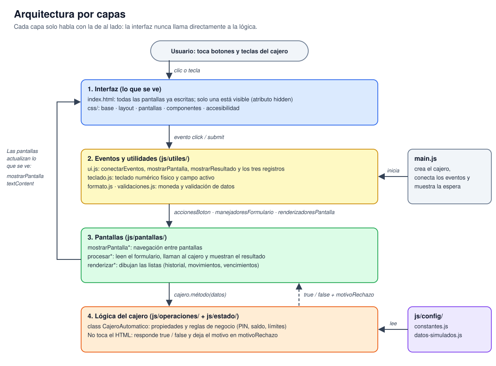
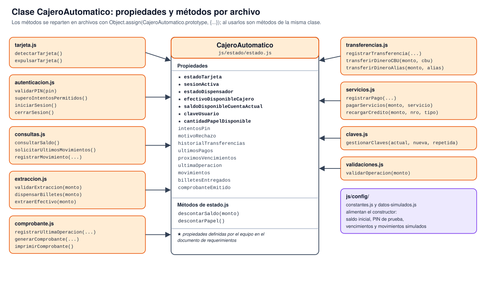
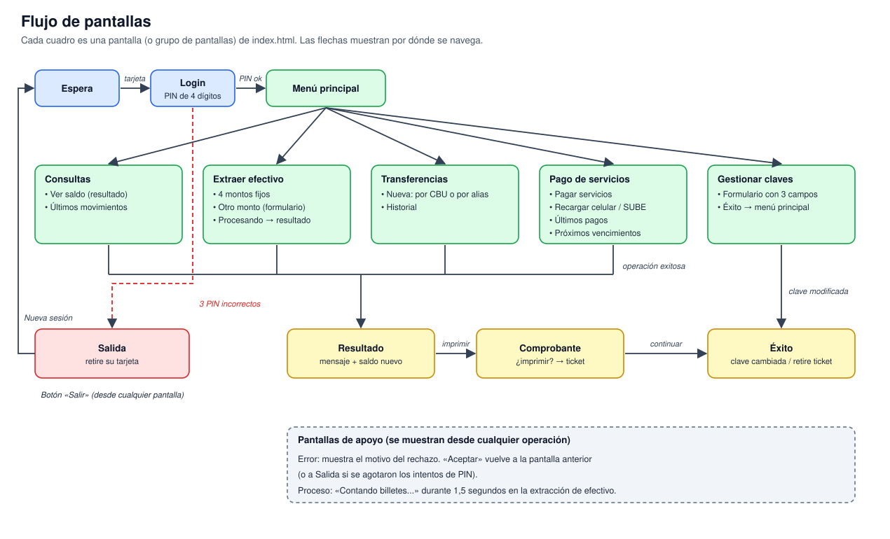
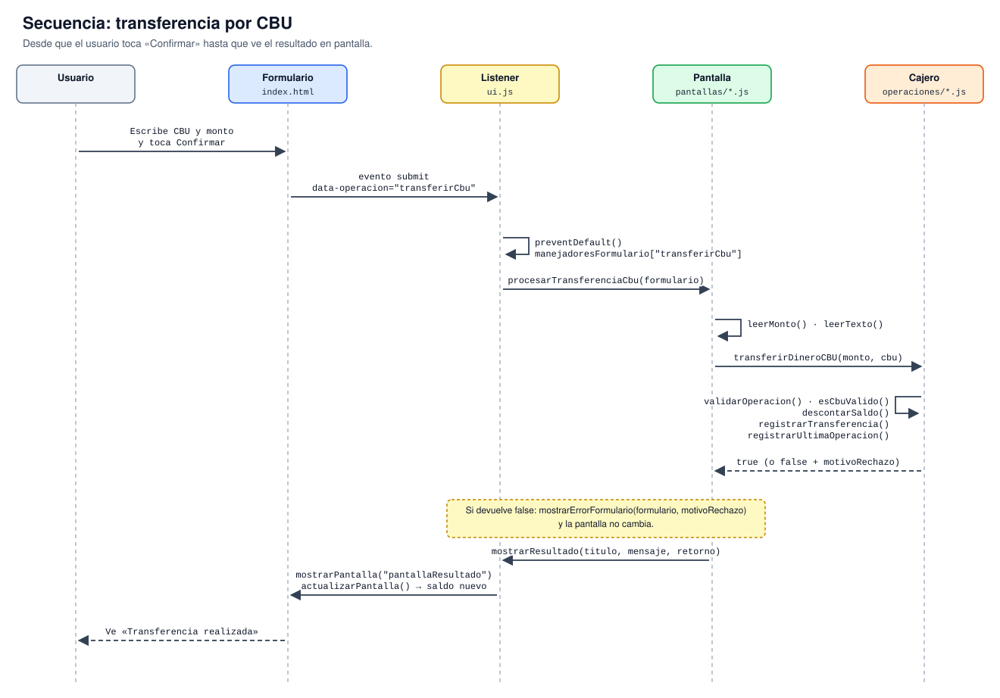
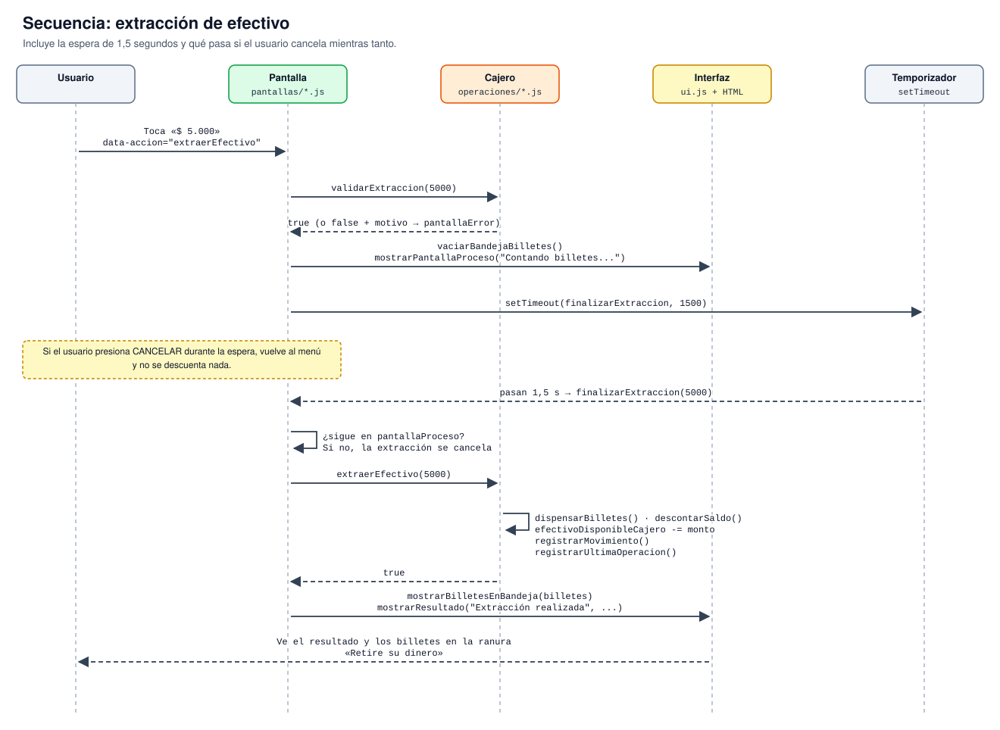
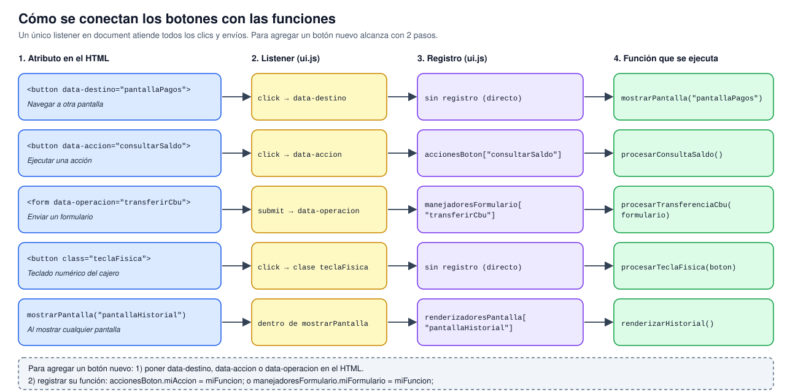

# Diagramas del proyecto

Los diagramas explican cómo interactúan la interfaz, las pantallas, los eventos y la lógica del cajero. Cada uno está en formato SVG (se ve en GitHub y se puede editar con Inkscape o draw.io)

## 1. Arquitectura por capas

La interfaz (HTML y CSS) no llama directamente a la lógica. Los eventos llegan a `ui.js`, de ahí pasan a las pantallas, y solo las pantallas le piden trabajo al objeto `cajero`. La lógica responde `true` o `false` y deja el motivo en `motivoRechazo`.

## 2. Clase CajeroAutomatico

Propiedades en `estado.js` y métodos repartidos por archivo mediante `Object.assign(CajeroAutomatico.prototype, {...})`. Las propiedades con estrella son las definidas por el equipo en el documento de requerimientos.

## 3. Flujo de pantallas

Recorrido completo del usuario: espera, login, menú principal, los cinco grupos de operaciones y las pantallas compartidas (resultado, comprobante, éxito, error, proceso y salida).

## 4. Secuencia: transferencia por CBU

Qué pasa, paso a paso, desde que el usuario toca "Confirmar" hasta que ve el resultado. Es el mismo patrón que siguen los pagos, las recargas y el cambio de clave.

## 5. Secuencia: extracción de efectivo

Incluye la pantalla de proceso de 1,5 segundos y qué ocurre si el usuario cancela mientras tanto: la operación recién se ejecuta cuando termina la espera, así que cancelar no descuenta nada.

## 6. Cómo se conectan los botones con las funciones

Resumen de los tres atributos del HTML (`data-destino`, `data-accion`, `data-operacion`), el listener único de `ui.js` y los registros donde cada pantalla anota sus funciones.
